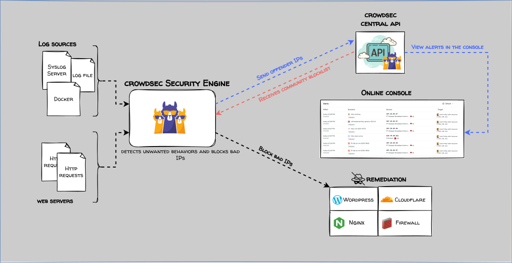

<h1>
  <p align="center" width="100%">
    
    <br>
    Crowdsec
  </p> 
</h1>

<h2> 
  <p align="center" width="100%">
    Crowdsec es un sistema que detecta y bloquea intentos de acceso no deseados a varios niveles mediante el análisis de registros, comparándolos con patrones de amenaza conocidos llamados escenarios y compartiendo los resultados entre todos los usuarios.
  </p>
</h2>

<h3> 
  <p align="left" width="100%">
    Basado en el contenedor oficial de <a href="https://crowdsec.net">Crowdsec</a> y el "rebotador" de <a href="https://github.com/maxlerebourg">maxlerebourg</a>
</h3>

[](README.md)

<h3>
  Contenido:
</h3>

- [Estructura](#estructura)
- [Descripción](#descripción)
  - [*¿Cómo funciona Crowdsec?*](#cómo-funciona-crowdsec)
  - [*Archivos*](#archivos)
  - [*Modificaciones en Traefik*](#modificaciones-en-traefik)
  - [*Colecciones*](#colecciones)
  - [*Perdona... ¿El comando `qué`?*](#perdona-el-comando-qué)
  - [*Variables de entorno*](#variables-de-entorno)
  - [*Antes de empezar*](#antes-de-empezar)
- [Arranque del contenedor y configuración inicial](#arranque-del-contenedor-y-configuración-inicial)
- [EXTRA - Post instalación](#extra---post-instalación)

## Estructura

    crowdsec/
      ├─ docker-compose.yml               → archivo docker
      ├─ .env                             → variables de entorno
      ├─ cs-private-key                   → archivo con el token para el rebotador (ver más adelante)
      └─ acquis.d/                        → adquisición de logs (ver más adelante)
           ├─ traefik.yaml                → configuración para el servicio Traefik
           └─ otros servicios...

## Descripción

### *¿Cómo funciona Crowdsec?*
<br>
<figure>
  <p align="center" width="100%">
    
    <figcaption align="center"><i>El flujo de trabajo de Crowdsec (imagen © Crowdsec)</i></figcaption>
  </p>
</figure>

Crowdsec está dividido en varios componentes. Aunque la explicación de cada uno [es mucho más técnica](https://docs.crowdsec.net/docs/intro), para simplificar diremos que se divide en:

  * **Datos de entrada (Data Sources)**: Son los archivos .log de nuestros servicios, o peticiones HTTP de nuestras aplicaciones. Crowdsec necesita leerlos para averigüar si hay alguna conducta sospechosa.
  * **Motor de seguridad (Security Engine)**: Es el componente encargado de orquestar todas las partes de Crowdsec. Se compone a su vez de:
    * **Una API Local (LAPI)**: Es una interfaz que envía las alertas y las decisiones a una base de datos. Una vez allí les permite a los *rebotadores* hacer uso de ellas.
    * **Analizadores (Parsers)**: Son los encargados de leer un registro en concreto y "entender" lo que pone en ellos. Hay prácticamente un parser para cada tipo de servicio/aplicación.
    * **Escenarios (Scenarios)**: Cuando el parser encuentra un patrón sospechoso conocido éste se compara con los escenarios que tengamos instalados. Si existe coincidencia se manda una alerta al API local.
    * **Decisiones (Decisions)**: Son la consecuencia que se desencadena cuando se recibe un número determinado de alertas.
  * **Componentes de remediación (Bouncers)**: Comúnmente conocidos como *"rebotadores"*, son los que se encargan de ejecutar las decisiones.
  * **API Central (Crowdsec CAPI)**: La interfaz en los servidores de Crowdsec que centraliza los datos de los "malos actores" y la distribuye entre sus usuarios. Además tendremos acceso a la...
  * **Consola**: Desde quí podremos gestionar nuestras máquinas, listas de bloqueo y alertas entre otras muchas funcionalidades a través de la plataforma online.

Lo que hace que Crowdsec sea tan potente es que **aprovecha la comunidad para compartir datos de los "malos actores"** entre todos los usuarios. De esta manera podemos **evitar un ataque antes siquiera de que se produzca** todo el proceso descrito más arriba.

### *Archivos*

Como viene siendo habitual, tanto `docker-compose.yml` como `.env` no necesitan presentación. Son los archivos que contienen todas las instrucciones y variables para crear el contenedor de Crowdsec.

El archivo `cs-private-key` contiene el *token* para el rebotador. Este token aleatorio es necesario para enlazar el plugin de Traefik con este contenedor. Está vacío porque lo generaremos una vez hayamos levantado el contenedor.

>**ESTE MÉTODO ESTÁ OBSOLETO, PERO SE DEJA COMO EXPLICACIÓN**
El archivo que define dónde están los logs y de qué tipo son es `acquis.yaml` **(nótese la extensión `.yaml` y no `.yml`)**. Aquí indicaremos a Crowdsec cuáles son los registros que queremos que sean analizados, que deberán estar previamente enlazados desde el archivo `docker-compose.yml` para que así puedan ser leídos desde dentro del contenedor.

En su lugar, ahora se utiliza la carpeta `acquis.d/`. Dentro de ella crearemos un archivo por cada tipo de servicio que queramos analizar. La estructura del archivo es exactamente la misma que se explica más adelante.

La estructura del archivo `.yaml` se compone de una sección `filenames` con los registros a analizar (uno o más archivos) y una sección `labels`, donde especificamos qué tipo de datos se espera dentro de cada uno para que el motor de seguridad los pase al analizador adecuado.

>**Nota**: **En la mayoría de casos con pasar los registros de Traefik es más que suficiente**. Aún así podemos pasar también los de Nginx, Apache, Nextcloud, etc. para intentar mejorar la protección frente a ataques. Pero esto tiene un coste de cómputo, por lo que hay que tener en cuenta el aumento de uso de CPU y memoria. Se han dejado algunos ejemplos (comentados) de servicios ya vistos en éste repositorio en `docker-compose.yml` y `acquis.d/`

**En resumen:**

  * Introducimos el nombre de uno o varios archivos que han de ser analizados por el motor de seguridad.
  
  * Indicamos a qué servicio o aplicación pertenecen para poder analizarlos con el *parser* adecuado.

### *Modificaciones en Traefik*

Es necesario hacer unas modificaciones en Traefik para que trabaje en coordinación con Crowdsec. En este mismo repositorio encontrás [una sección dedicada a Traefik](../traefik/). En aquel ejemplo, tanto `docker-compose.yml`, `traefik.yml`, `middlewares.yml` y `middlewares-chains.yml` cuentan con todas las líneas necesarias, pero comentadas. Simplemente hay que descomentarlas y reiniciar Traefik para que se apliquen.

En otras guías existentes en Internet es habitual encontrar el servicio Crowdsec junto al servicio [Traefik-Crowdsec-Bouncer](https://github.com/fbonalair/traefik-crowdsec-bouncer) de [Fabien Bonalair](https://github.com/fbonalair), como contenedor adicional dentro del archivo `docker-compose.yml`. No obstante, en el momento de escribir esta guía dicho contenedor lleva 2 años sin actualizarse y desde entonces han surgido nuevas funcionalidades (como soporte para AppSec), por lo que en ésta ocasión utilizaremos el plugin [Crowdsec-Bouncer-Traefik-Plugin](https://github.com/maxlerebourg/crowdsec-bouncer-traefik-plugin) de [maxlerebourg](https://github.com/maxlerebourg). **Desde aquí mi más sincero agradecimiento a ambos por su trabajo.**

La diferencia más notable entre los dos *rebotadores* es que el plugin se define dentro del archivo de configuración de Traefik `traefik.yml` y no como otro servicio en `docker-compose.yml`, por lo que no es necesario levantar ningún contenedor adicional junto a Crowdsec.

>Si además somos usuarios del **proxy de Cloudflare** (la famosa nube naranja), aprovecharemos para introducir también el *plugin* [Real IP from Cloudflare Proxy/Tunnel](https://plugins.traefik.io/plugins/62e97498e2bf06d4675b9443/real-ip-from-cloudflare-proxy-tunnel) de [BetterCorp](https://github.com/BetterCorp) **(gracias también a BetterCorp desde aquí)**, que permite traspasar la IP real de la máquina que pide acceso desde la parte pública de nuestro router a los servicios que tenemos en nuestra red privada.
>En realidad esto **no es necesario para Crowdsec**, ya que Traefik es capaz de escribir la IP real en su registro de acceso, pero **otros servicios que utilicemos** más adelante (y que no tengan por qué acceder a los registros) **sí que lo necesitarán**. Además no hace daño a nadie, por lo que lo dejamos activado. 😎👍

En el archivo `traefik.yml` descomentamos lo siguiente:

```yaml
experimental:
  plugins:
    cloudflarewarp:
      moduleName: 'github.com/BetterCorp/cloudflarewarp'
      version: 'v1.3.3'
# comprobar la versión más actualizada en https://plugins.traefik.io/plugins/62e97498e2bf06d4675b9443/real-ip-from-cloudflare-proxy-tunnel
    crowdsec-bouncer:
      moduleName: 'github.com/maxlerebourg/crowdsec-bouncer-traefik-plugin'
      version: 'v1.3.5'
# comprobar la versión más actualizada en https://plugins.traefik.io/plugins/6335346ca4caa9ddeffda116/crowdsec-bouncer-traefik-plugin
```
>

Y en el archivo `middlewares.yml` descomentamos lo siguiente:
```yaml
      middlewares-crowdsec-bouncer:
        plugin:
          crowdsec-bouncer:
            enabled: true
            logLevel: INFO
            updateIntervalSeconds: 60
            updateMaxFailure: 0
            defaultDecisionSeconds: 60
            httpTimeoutSeconds: 10
            crowdsecMode: live
            crowdsecLapiKeyFile: /etc/traefik/cs-private-key
            crowdsecLapiHost: crowdsec:8080
            crowdsecLapiScheme: http
            forwardedHeadersCustomName: X-Custom-Header
              clientTrustedIPs:
                - "192.168.0.0/24"
                - '172.16.0.0/10'
```
>

>Podemos ajustar cada parámetro a nuestras necesidades (hay muchos más, consultar la documentación de Crowdsec). Las tres últimas líneas son para que Traefik no considere como IP de cliente a las máquinas de nuestra red (se muestran dos rangos de ejemplo). Son opcionales.

En el archivo `middlewares-chains.yml` descomentamos la línea correspondiente a Crowdsec de cada bloque. Están comentadas, no tienen pérdida.

Por último, **totalmente opcional pero muy recomendable**, es configurar el contenedor Traefik con una **IP fija**. Esto es así porque cada vez que reiniciemos y se nos asigne una IP distinta a cualquiera anterior, Crowdsec generará un nuevo bouncer (con el mismo nombre y la @IP como sufijo) y en la aplicación web aparecerá un número irreal de elementos. Reconozco que el cambio es más estético que práctico, ya que no dejará de cumplir su cometido, pero me gusta tenerlo todo aseado. 😎

Para ello sólo hay que descomentar las líneas correspondientes en el archivo `docker-compose.yml` (líneas 7-10,26,27) **y ajustar tanto el rango del bloque networks, como la IP del servicio traefik a las que tengamos en nuestro entorno.**

### *Colecciones*

Toda esta teoría está muy bien, pero tenemos tantos términos que esto parece algo complicadísimo de configurar. Entre analizadores, escenarios, rebotadores y demás es normal que todo sea muy confuso.

A nuestro rescate acude **otro término más 🤣 : [las colecciones](https://app.crowdsec.net/hub/collections)**. Afortunadamente estas harán que nos olvidemos de todos los otros términos, al menos en la parte práctica. Me explico:

> ***Una colección es el conjunto de analizadores, escenarios y la forma en que todos están en coherencia para funcionar en un caso concreto.***

De esta forma, en lugar de tener que preocuparnos por los detalles de cada componente, podemos descargar un **"paquete"**. Cada paquete se encarga de todo lo necesario para analizar y tomar las decisiones ante los intentos de ataque hacia la aplicación a la que está dirigida: Wordpress, Nextcloud, sistema operativo Windows... Es más, podemos descargar tantas colecciones como queramos en un mismo motor de seguridad **siempre dentro de una lógica**. No tiene ningún sentido instalar una colección para proteger el panel de control de un router Mikrotik si tenemos un router con OPNsense.

En el caso que nos ocupa, y por abreviar, descargaremos las colecciones básicas para el sistema Linux, algunas comunes para servicios http y para Traefik. Esto podemos hacerlo bien como variable de entorno en `docker-compose.yml` (ya están seleccionadas las mínimas en nuestro ejemplo) o ejecutando **el comando `cscli`** una vez el contenedor esté en servicio.

### *Perdona... ¿El comando `qué`?*

El comando más significativo de Crowdsec es `cscli` (CrowdSec Command Line Interface). Es nuestra forma de interactuar localmente con él. Tiene un gran número de opciones que no abarcaremos aquí, por lo que nos centraremos en las más comunes:

  * `cscli bouncers`   : Para ver, añadir o quitar rebotadores.
  * `cscli collections`: Lo mismo pero con las colecciones.
  * `cscli console`    : Para dar de alta el servicio web, (des)habilitarlo o ver su estatus.
  * `cscli decisions`  : Para ver las decisiones tomadas y/o añadirlas o eliminarlas manualmente.
  * `cscli metrics`    : Un vistazo rápido en forma de tabla con todos los datos de Crowdsec.

Como este comando "vive" dentro del contenedor, tendremos que ver la forma de trabajar con él. Las formas más habituales son:

* **Desde fuera del contenedor, si solo vamos a ejecutar un comando**
```bash
docker exec <contenedor> <comando>
```
>

>Siendo `<contenedor>` el nombre del contenedor y `<comando>` lo que queremos que se ejecute dentro.

* **Entrando en el contenedor, si tenemos que ejecutar varias tareas**
```bash
docker exec -it <contenedor> /bin/sh
# (en algunos casos también se puede usar /bin/bash)
```
>

>De esta manera nos introducimos en el propio contenedor (`-it` indica ***interactive***) y así ejecutamos todos los comandos que necesitemos. Pensad en este método como una especie de "ssh".

### *Variables de entorno*

Tan solo una:

* `DOCKERDIR` como siempre, es el directorio raíz que contiene todos los servicios de Docker.

### *Antes de empezar*

* Si vamos a utilizar otros archivos de registro (Nextcloud, Authelia...), comprobar que están enlazados en la sección `volumes:` de `docker-compose.yml` y que tienen un archivo dedicado en `acquis.d/`
* Hemos descomentado todas las líneas necesarias en `docker-compose.yml`, `traefik.yml`, `middlewares.yml` y `middlewares-chains.yml` del servicio [Traefik](../traefik/). **Reiniciar el contenedor una vez hecho.**

## Arranque del contenedor y configuración inicial

```bash
docker compose up -d       → arrancamos Crowdsec en segundo plano

docker logs crowdsec -f    → examinamos los registros para ver si hay algún problema (CTRL+c para salir)
```

Pasados unos instantes para dejar que el contenedor se inicie por completo, ejecutamos el siguiente comando para generar el Token:

**¡Importante!**: el token solo se mostrará **UNA** vez, si no lo copiamos **¡tendremos que eliminar el bouncer y comenzar de nuevo!**
```bash
docker exec crowdsec cscli bouncers add traefik-bouncer
```
>
Se mostrará un código aleatorio en pantalla. Copiamos ese código y lo guardamos en el archivo `cs-private-key`. Ahora reiniciaremos ambos servicios:

```bash
docker restart traefik crowdsec
```
>

Dejamos pasar unos minutos para que se reinicie todo correctamente. En el registro de `crowdsec` empezaremos a ver cosas interesantes:

    ..."loading acquisition file : /etc/crowdsec/acquis.d/traefik.yaml"
    ..."Adding file /var/log/traefik.log to datasources" type=file
>

Podemos comprobar si ha reconocido el bouncer (es posible que no aparezca toda la información durante los primeros minutos):
```bash
docker exec crowdsec cscli bouncers list
----------------------------------------------------------------------------------------------------------------
 Name             IP Address   Valid  Last API pull         Type                             Version  Auth Type 
----------------------------------------------------------------------------------------------------------------
 traefik-bouncer  10.0.0.10    ✔      2024-12-12T19:29:24Z  Crowdsec-Bouncer-Traefik-Plugin  1.X.X    api-key   
----------------------------------------------------------------------------------------------------------------
```
>

Vamos a añadir una colección de ejemplo para uno de los servicios comentados a lo largo del documento, ***Nextcloud***
```bash
docker exec crowdsec cscli collections install nextcloud
```
>


Por último, iremos [a la consola de Crowdsec](https://app.crowdsec.net), hacemos click en el botón ***Sign up for free*** y creamos una cuenta.
En la sección ***Security Engines → Engines*** hacemos click en  ***Add Security Engine***.
Aparecerán dos bloques: el primero con enlaces a cómo configurar un Motor de seguridad según el Sistema Operativo (ya lo hemos hecho), y el segundo bloque donde nos dice: ***Enroll your CrowdSec Security Engine:***

    sudo cscli console enroll -e context blahblahblahblahblahblah

Copiamos el comando y lo pegamos en el terminal. Responderá algo como

```bash
INFO[2024-12-12T19:50:17Z] manual set to true
INFO[2024-12-12T19:50:17Z] Enabled manual : Forward manual decisions to the console
INFO[2024-12-12T19:50:17Z] Enabled tainted : Forward alerts from tainted scenarios to the console
INFO[2024-12-12T19:50:17Z] Watcher successfully enrolled. Visit https://app.crowdsec.net to accept it.
INFO[2024-12-12T19:50:17Z] Please restart crowdsec after accepting the enrollment.
```
>

Nos pide que aceptemos la solicitud en [la consola de Crowdsec](https://app.crowdsec.net). Hacemos click en ***Accept enroll*** y por último volvemos a reiniciar Crowdsec.

<h3>
¡Listo! Ahora contamos con una capa de seguridad extra apoyada en una gran comunidad.
</h3>

## EXTRA - Post instalación

Crowdsec ofrece una protección notable con la cuenta gratuíta. Para sacarle todo el partido a la misma, podemos suscribirnos a un máximo de tres listas adicionales de la sección ***Blocklists***: filtramos por ***Free***, elegimos la que más nos guste y dentro hay una sección ***Security Engines***. Aquí podremos añadir nuestro recién creado motor de seguridad, siendo obligatorio elegir qué comportamiento queremos que tenga el bouncer ante un evento positivo de la lista: Banear, presentar un Captcha u otros (avanzado).

Realizaremos ésta operación con hasta otras dos listas más. Las tres listas que elijamos están asociadas a la cuenta y no al motor, por lo que si damos de alta más instalaciones tendrán que hacer uso de las mismas tres listas. Aunque se pueden cambiar en cualquier momento, lo ideal es que, si vamos a hacer un uso intensivo, pensemos en adquirir una subscripción. Tiene muchos beneficios a parte de la cantidad y calidad de las listas de bloqueo.

***Además si el servidor central (CAPI) va recibiendo nuestros datos periódicamente, Crowdsec nos asignará una cuarta lista, Crowdsec Community Blocklist.***

Y hasta aquí por hoy. ¡Nos vemos en el próximo servicio!