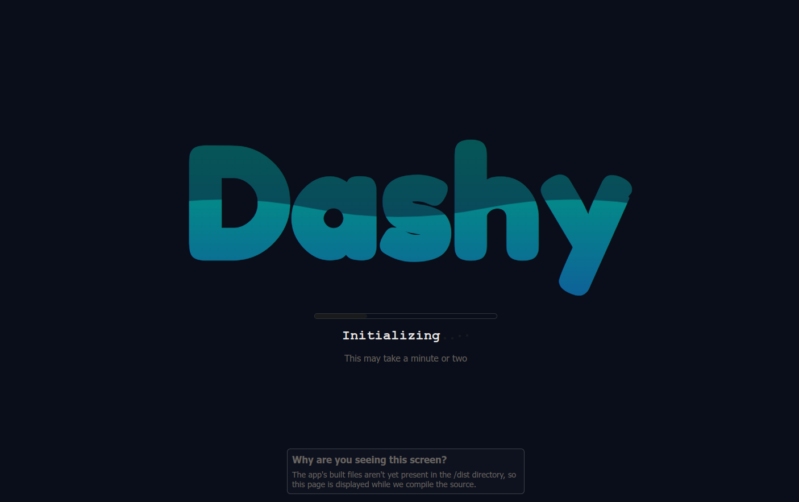
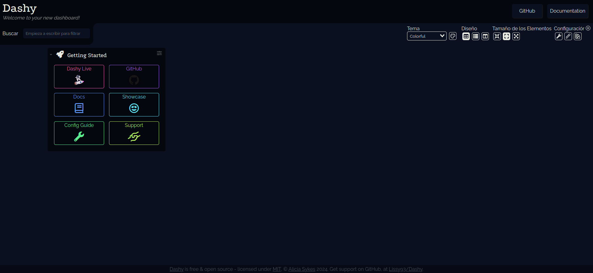
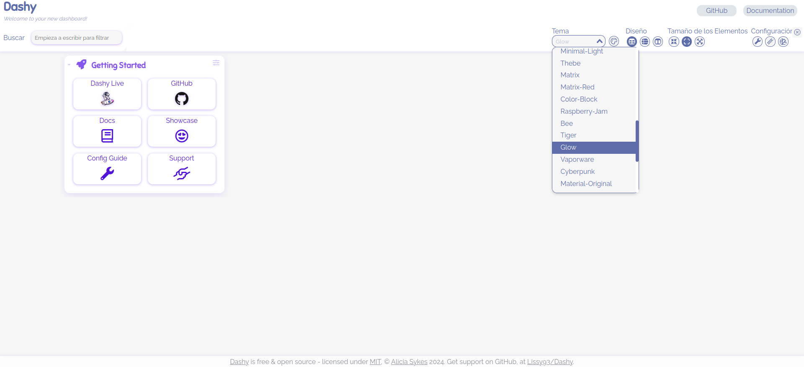
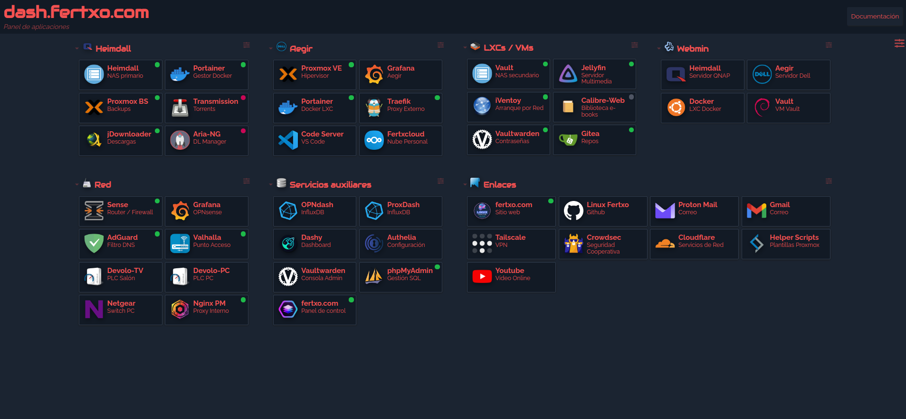

<h1>
  <p align="center" width="100%">
    
    <br>
    Dashy
  </p> 
</h1>

<h2> 
  <p align="center" width="100%">
    Un excepcional panel de control con widgets, verificaciones de estado y un completo editor visual con infinitas⁽¹⁾ posibilidades
      <h5>
        ⁽¹⁾ JavaScript 😎
      </h5>
  </p>
</h2>

<h3>
  <p align="center" width="100%">
    Basado en la <a href="https://github.com/Lissy93/dashy">imagen</a> de <a href="https://www.aliciasykes.com">Alicia Sykes</a> (<a href="https://github.com/Lissy93">@Lissy93</a>)
  </p>
</h3>

[](README.es.md)

<h3>Contenido:</h3>

- [Estructura](#estructura)
- [Descripción](#descripción)
  - [*Docker compose*](#docker-compose)
    - [*Ports*](#ports)
    - [*Certificados SSL*](#certificados-ssl)
    - [*Chequeo de salud*](#chequeo-de-salud)
  - [*El archivo `dashy.yml`*](#el-archivo-dashyyml)
  - [*La carpeta `icons/` (y puede que también `fonts/`)*](#la-carpeta-icons-y-puede-que-también-fonts)
  - [*Características de Dashy*](#características-de-dashy)
    - [*Widgets*](#widgets)
    - [*Indicadores de estado*](#indicadores-de-estado)
    - [*Temas*](#temas)
    - [*Autenticación*](#autenticación)
    - [*Copia de seguridad y restauración en la nube*](#copia-de-seguridad-y-restauración-en-la-nube)
    - [*Iconos*](#iconos)
  - [Antes de empezar](#antes-de-empezar)
- [Primer arranque](#primer-arranque)

## Estructura

    dashy/
      ├─ docker-compose.yml               → archivo docker
      ├─ .env                             → variables de entorno
      ├─ dashy.yml                        → configuración de dashy (opcional)
      ├─ icons/                           → iconos personalizados (opcional)
      └─ fonts/                           → fuentes personalizadas (opcional)

## Descripción

Los archivos `docker-compose.yml` y `.env`, como siempre, no necesitan introducción. Estos son los archivos que contienen todas las instrucciones y variables para crear el stack de Dashy. Veamos algunos bloques dentro del archivo `docker-compose.yml`.

### *Docker compose*

#### *Ports*

```yaml
    ports:
      - $HTTP:8080
```
>

Aquí me gustaría señalar que el puerto del lado del host se ha asignado a una variable, para que pueda adaptarse a vuestras necesidades. Ajustar la variable en `.env` en consonancia.

Esta desviación en la forma normal de proceder se debe al hecho de que (probablemente) ya tengamos muchos puertos ocupados en el servidor. Siempre podemos poner uno y fijarlo si es nuestra preferencia. En cualquier caso, el puerto de ejemplo en el archivo '.env` es el más habitual.

#### *Certificados SSL*

```yaml
    volumes:
      - $ACME_PATH/example.cer:/etc/ssl/certs/dashy-pub.pem:ro
      - $ACME_PATH/example.key:/etc/ssl/certs/dashy-priv.key:ro
```
>

En caso de que queramos usar nuestros propios certificados, necesitaremos descomentar estas líneas en la sección 'volumes:'. Ajustar la variable `$ACME_PATH` para apuntar a la ubicación correcta en el archivo `.env`.

#### *Chequeo de salud*

Justo al final de `docker-composa.yml` está la sección `healthcheck:`.

```yaml
    healthcheck:
      test: ['CMD-SHELL', 'yarn health-check']
      interval: 5m
      retries: 3
      start_period: 1m
      timeout: 30s
```
>

En este caso estamos utilizando el comando `yarn health-check` de la shell (`CMD-SHELL`) para verificar el estado del contenedor, a intervalos de 5 minutos, permitiendo hasta 3 reintentos, con un período de inicio de 1 minuto y un tiempo de agotamiento de 30 segundos.

> **¿Qué es Yarn?**
> Yarn es un administrador de paquetes para Node.js, y está incorporado en la imagen de Dashy puesto que es lo que su desarrolladora ha utilizado para construir la aplicación.

> **Nueva técnica: verificaciones de salud en contenedores**
> De aquí en adelante, **podremos usar otros comandos** que estén dentro de un contenedor, con la misma sintaxis, **para realizar nuestros propios chequeos de salud**. O también podemos crear nuestras propias imágenes Docker con los comandos que sean más relevantes para nosotros.

### *El archivo `dashy.yml`*

Si tenemos un archivo de configuración personalizado, podemos pasarlo al contenedor vinculándolo como volumen. Si no está presente, Dashy creará uno predeterminado dentro del contenedor y usarlo como punto de partida para nuestros cambios. Hay tres formas de hacer modificaciones en Dashy:

* **Método Directo:** Crea el archivo `dashy.yml` con tu editor favorito y pásalo luego al contenedor. Haz clic [aquí](https://dashy.to/docs/configuring#contents) para acceder a la documentación completa.
* **Desde la interfaz, mediante el editor embebido:** Que incluye validación de sintaxis, alguna ayuda y otras opciones avanzadas. Está disponible a través del icono con forma de herramienta en el menú de configuración **≡**.
* **Desde la interfaz, con el Editor Visual:** Que proporciona una forma conveniente de ver los resultados a medida que hacemos cambios. Se puede acceder a través del icono con forma de lápiz en el menú de configuración **≡**.

No obstante, lo que recomiendo es comenzar con la configuración vacía predeterminada (sin el archivo `dashy.yml`), definir luego la estructura con el Editor Visual y finalmente hacer retoques con el editor JSON integrado si necesitamos acceder a ajustes más avanzados que de otro modo no son accesibles.

### *La carpeta `icons/` (y puede que también `fonts/`)*

Aunque Dashy proporciona muchas formas de agregar íconos a nuestro tablero (lo veremos en un momento), es posible que los que haya no nos satisfacen o queremos agregar otros. Para consegurilo lo que haremos es mapear la carpeta `icons/` a una carpeta del host y luego hacer referencia a ella en `docker-compose.yml`. De esta manera, cualquier icono que coloquemos dentro de la carpeta estará disponible para su uso en el tablero.

> ***Consejo:*** 
> También podemos descomentar la línea 31 en la sección `volumes:` de `docker-compose.yml` para mapear la carpeta `fonts/` e incluir cualquier fuente que nos guste.

### *Características de Dashy*

#### *Widgets*

Dashy tiene un rico conjunto de widgets que pueden usarse para mostrar información en el panel, tante desde fuentes locales como remotas. Puedes encontrarlos en la sección [Widgets](https://dashy.to/docs/widgets) de la documentación.

#### *Indicadores de estado*

Dashy también cuenta con verificaciones de estado que podemos configurar para monitorizar la disponibilidad de nuestros servicios. Podemos configurarlos para bypasar la verificación SSL si fuera necesario, especificar encabezados personalizados, etc. También podemos apuntar a un endpoint diferente (URL/ruta) para obtener un código 200 (OK), o simplemente aceptar otros códigos de estado diferentes. Puedes encontrar todo en la sección [Status Indicators](https://dashy.to/docs/status-indicators) de la documentación.

#### *Temas*

Dashy cuenta con un buen número de temas predefinidos que podemos usar para personalizar nuestro panel. Cada uno de los elementos se puede ajustar a nuestro gusto, desde los colores, las fuentes, estilos CSS y demás. Y, por supuesto, también podemos cargar un tema completo personalizado (avanzado). Echa un vistazo a la sección [Themes](https://dashy.to/docs/themes) de la documentación.

#### *Autenticación*

Dado que esta guía supone que el tablero es para uso personal y accedido desde nuestra red local, está fuera del alcance de éste tutorial cómo configurar la autenticación, pero os puedo adelantar que también contamos con muchas opciones para hacerlo. Da una vuelta por la sección [Authentication](https://dashy.to/docs/authentication) de la documentación para saber más.

#### *Copia de seguridad y restauración en la nube*

Una característica fantástica de Dashy es la capacidad de hacer una copia de la configuración en la nube y poder restaurarla. La desarrolladora Lissy afirma que la información se encripta antes de subir y que es 100% seguro, por lo que podemos confiar en ella o no. Personalmente, lo he estado usando por un tiempo y estoy muy contento con esta característica; no veo tampoco una mala intención por parte de la desarrolladora. Podemos encontrar esta característica en el icono en forma de herramienta en el menú de configuración **≡**.

> ***Pero cuidado:*** 
> Haz siempre una copia de seguridad fuera de esta nube, ya que se basa en cookies para mantener las copias sobre el mismo token generado. Si accidentalmente o intencionalmente limpiamos las cookies, **¡La copia de seguridad remota se perderá!**
> La mejor manera de hacerlo es abrir el editor JSON incorporado, copiar todos los contenidos y pegarlos en otro lugar. **Ten en cuenta también que esta copia de seguridad es un archivo JSON, no YAML,** por lo que no se puede usar como `dashy.yml` en` docker-compose.yml`. Si es necesario, es preferible empezar desde cero y luego restaure la copia de seguridad en el editor JSON. Es mucho más fácil (y rápido) que convertir JSON a YAML.

#### *Iconos*

Dashy admite varios proveedores diferentes para agregar iconos al tablero:

* **Favicon:** Dashy puede buscar automáticamente un icono para un servicio determinado, utilizando su favicon. Simplemente establecemos `icon: favicon` para usar esta función. Ya que los sitios alojan sus favicons en diferentes rutas, para obtener los mejores resultados Dashy puede usar una API para obtener el icono de un sitio web. La API de Favicon predeterminada es allesedv.com, pero puede se puede cambiar en `appconfig.faviconapi`. Si prefierimos no usar una API, simplemente pondremos este valor en `local`. También podemos usar diferentes API para elementos individuales, configurando el icono: `favicon-[API]`, p.ej: `favicon-clearbit`.
Se admiten las siguientes API:
  * **allesedv** - allesedv.com es un servicio altamente eficiente con soporte IPv6.
  * **iconhorse** - [Icon.Horse](https://icon.horse/) devuelve íconos de calidad para cualquier sitio, con almacenamiento en caché y alternativas para sitios sin icono.
  * **clearbit** - [Clearbit](https://clearbit.com/logo) devuelve iconos de gran calidad para los sitios más populares.
  * **besticon** - [BestIcon](https://github.com/mat/besticon) es una herramienta que obtiene (y genera) iconos del Manifest del sitio.
  * **mcapi** - [MC-API](https://eu.mc-api.net/) obtiene el Favicon predeterminado de un sitio web, originalmente era una utilidad para Minecraft.
  * **duckduckgo** - Devuelve iconos de una calidad decente desde búsquedas hechas en DuckDuckGo.
  * **google** - El API oficial del servicio Favicon de Google. Buen soporte para todos los sitios, pero una calidad muy pobre.
  * **yandex** - Iconos de baja calidad, pero útil para algunas regiones donde otros servicios están son bloqueados.
  * **local** - Establece el icono predeterminado en /favicon.ico en lugar de usar una API.
  * Si para una API no se puede encontrar el icono, o no es accesible, entonces la mejor opción es usar la URL directa de la imagen del icono. Por ejemplo, escribiendo la ruta `https://monitoring.local/faviconx128.png` - podemos encontrar esta ruta usando las herramientas de desarrollo del navegador (Normalmente pulsando la tecla F12).
* **Font-Awesome:** Podemos usar cualquier icono de Font-Awesome simplemente especificando su `id`. Este sigue el formato `[categoría] [nombre]` y se puede consultar en la página de [Font-Awesome](https://fontawesome.com). Por ejemplo: `fas fa-rocket`,`fab fa-monero` o `fas fa-unicorn`. Font-Awesome tiene una amplia variedad de íconos gratuitos, pero también podemos usar sus íconos exclusivos si contamos con una cuenta premium. Consultar la documentación de Dashy para agregar una cuenta premium.
* **Simple Icons:** [SimpleIcons.org](https://simpleicons.org) es una colección con más de 2000+ iconos de marcas y logos en formato SVG de gran calidad, libres y de código abierto. Su uso es muy similar a Font-Awesome. Primero encontramos el icono que queremos usar en la web, y luego simplemente lo establecemos con el prefijo `si-`.
* **Generative Icons:** Usa un icono único y generado aleatoriamente para un servicio determinado. Esto es particularmente útil cuando se tiene muchos servicios similares con una IP o puerto diferente, y sin un icono específico.Estos íconos se generan con [DiceBear](https://api.dicebear.com/) (o [evatar](https://evatar.io/) como alternativa), y usa un hash del dominio/IP del servicios como semilla para generar un icono único a cada servicio.
* **Emoji Icons:** Se puede usar cualquier emoji como icono para elementos o secciones. Podemos especificar el emoji directamente, usando su UNICODE (p.ej `'U+1F680'`) o shortcode (p.ej `':rocket:'`). Podemos encontrar estos códigos en [Emojipedia](https://emojipedia.org) (cerca de la parte inferior de la página de cada emoji).
* **Home-Lab Icons:** El repositorio [dashboard-icons](https://github.com/walkxcode/Dashboard-Icons) de [@WalkxCode](https://github.com/walkxcode) **(gracias desde aquí!!)** proporciona una colección exhaustiva de iconos de alta calidad en formato PNG para la mayoría de servicios de self-hosting más comunes. Dashy soporta estos iconos de forma nativa, especificando el nombre del icono (sin la extensión) precedidos de `hl-`. [Aquí](https://github.com/walkxcode/Dashboard-Icons/tree/main/png) tienes una lista con todos los iconos disponibles. Ten en cuenta que estos se obtienen y almacenan en caché directamente desde GitHub, por lo que si necesitamos acceso sin conexión, el método con iconos locales puede ser una mejor opción. **Personalmente, he estado usando una copia local de este repositorio en la carpeta `icons/`, junto con algunos personalizados**. El resultado lo puedes ver en la captura de pantalla del final.
* **Material Design Icons:** Dashy también soporta los más de 5000+ iconos de [material-design-icons](https://github.com/Templarian/MaterialDesign). Para utilizarlos, primero encontramos el nombre del icono [aquí](https://dev.materialdesignicons.com/icons), y luego lo establecemos con el prefijo `mdi-`.
* **Iconos por URL directa:** También podemos establecer el icono si tenemos una URL válida apuntando al mismo. Por ejemplo el icono `https://i.ibb.co/710B3Yc/space-invader-x256.png`, (u otro en los formatos .png, .jpg o .svg), que esté hospedado en cualquier sitio, local o remoto, siempre que esté accesible desde donde esté Dashy alojado. El icono se escalará automáticamente, no obstante si tiene que cargar muchos iconos grandes, esto puede tener un impacto negativo en el rendimiento, especialmente si visitamos Dashy desde muchos dispositivos.
* **Local Icons:** Como dijimos arriba, la forma más fiable es mapear la carpeta `icons/` en nuestro `docker-compose.yml`. De ésta manera siempre tendremos los iconos accesibles sin importar cualquier problema de conectividad que podamos tener.

### Antes de empezar

* Si tenemos pensado usar el archivo de configuración, o iconos/fuentes personalizados, asegurarse de tener la estructura de carpetas y archivos creada de antemano.

## Primer arranque

```bash
# ejecutar Dashy en segundo plano
docker compose up -d

# examinamos los registros para ver si hay algún problema (CTRL+c para salir)
docker logs dashy -f
```
>

Abre el navegador y accede a la dirección del servidor junto al puerto que hemos configurado en `docker-compose.yml`. Durante el primer arranque la apliación debe construirse, especialmente si no hemos pasado ningun archivo `dashy.yml` personalizado, por lo que se mostrará la siguiente pantalla:

  <p align="center" width="100%">
    
    <figcaption align="center"><i>Pantalla de arranque de Dashy</i></figcaption>
  </p>

<br>

Esto es lo que hemos estado buscando. Una vez que la aplicación esté en funcionamiento, podemos comenzar a personalizarla.

  <p align="center" width="100%">
    
    <figcaption align="center"><i>Panel por defecto</i></figcaption>
  </p>

  <p align="center" width="100%">
    
    <figcaption align="center"><i>También se incluyen temas luminosos (muy a mi pesar)</i> 😜</figcaption>
  </p>

<br>

Y aquí tenéis una captura de mi propio tablero:

  <p align="center" width="100%">
    
    <figcaption align="center"><i>Se pueden ver algunos iconos personalizados e indicadores de estado</i></figcaption>
  </p>

<br>
<h3>
¡Listo! ¡Ahora tenemos un flamante dashboard con el que dar envidia a nuestros colegas!
</h3>
</h4>
Quiero decir para aumentar nuestra productividad... ejem.
</h4>
